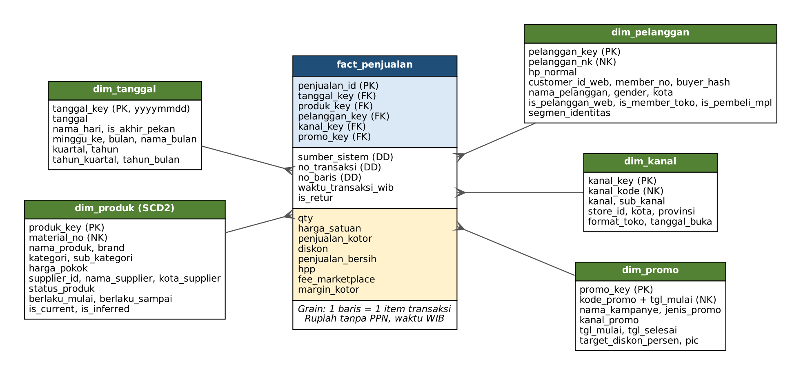

# Data Warehouse Nusantara Retail Group (NRG)

Tugas Kelompok 1 – Pengembangan Data Warehouse · Mata Kuliah Data Warehouse / Business Intelligence

| Nama | NIM | Peran |
|---|---|---|
| _Anggota 1_ | _NIM_ | Desain dimensional + dokumen |
| _Anggota 2_ | _NIM_ | ETL dimensi (t_01 – t_06) |
| _Anggota 3_ | _NIM_ | ETL fakta (t_07 – t_09) + Job |
| _Anggota 4_ | _NIM_ | Kueri pembuktian + laporan |

Satu tabel fakta (`fact_penjualan`, grain 1 baris = 1 item transaksi) dan lima dimensi (`dim_tanggal`, `dim_produk`, `dim_pelanggan`, `dim_kanal`, `dim_promo`) yang mengintegrasikan lima sumber:
S1 ECOM_DB (MySQL), S2 POS_TOKO (CSV `;`), S3 MPL_API (JSON), S4 ERP_MASTER (CSV), S5 MKT_SHEET (CSV).



## Struktur repositori

```
nrg-data-warehouse/
├── README.md                       ← file ini
├── data/                           ← paket data dari dosen (TIDAK diubah isinya)
│   ├── S1_ecom_db_schema_mysql.sql, load_all.py, ref_kota.csv
│   ├── S1_ECOM_DB/  S2_POS_TOKO/  S3_MPL_API/  S4_ERP_MASTER/  S5_MKT_SHEET/
├── sql/
│   ├── 01_ddl_dw.sql               ← DDL star schema (dipanggil otomatis oleh Job)
│   ├── 02_validasi_etl.sql         ← cek hasil ETL (jumlah baris & total harapan)
│   └── 03_kueri_pembuktian.sql     ← 4 kueri pembuktian (Q1–Q4)
├── pentaho/
│   ├── j_00_main_nrg_dw.kjb        ← Job utama (jalankan ini)
│   ├── t_01_dim_tanggal.ktr
│   ├── t_02_dim_kanal.ktr
│   ├── t_03_dim_promo.ktr
│   ├── t_04_dim_produk.ktr
│   ├── t_05_map_produk.ktr
│   ├── t_06_dim_pelanggan.ktr
│   ├── t_07_fact_web.ktr
│   ├── t_08_fact_toko.ktr
│   └── t_09_fact_marketplace.ktr
└── docs/
    ├── laporan_desain_dimensional.pdf   ← dokumen desain + laporan
    ├── star_schema.png
    ├── source_to_target_mapping.csv     ← peta S2T kolom demi kolom (153 baris)
    ├── source_to_target_mapping.md
    └── screenshots/                     ← bukti run Job & hasil kueri
```

## Prasyarat

| Komponen | Versi yang dipakai | Catatan |
|---|---|---|
| MySQL Server | 8.x | user `root`, port `3306` (sesuaikan) |
| Pentaho Data Integration (Spoon) | 9.x / 10.x | Java sesuai versi PDI |
| MySQL JDBC driver | mysql-connector-j 8.x | taruh `.jar` di `data-integration/lib/` |
| Python 3 + `pandas`, `mysql-connector-python` | – | hanya untuk memuat S1 (skrip dari dosen) |

## Cara menjalankan dari kondisi kosong

1. **Muat sumber S1 ke MySQL** (sekali saja):
   ```bash
   cd data
   mysql -u root -p < S1_ecom_db_schema_mysql.sql      # membuat database nrg_ecom
   python load_all.py                                   # memuat 11 CSV S1 ke nrg_ecom
   ```
2. **Atur variabel Pentaho** di `~/.kettle/kettle.properties` (Windows: `C:\Users\<user>\.kettle\kettle.properties`):
   ```properties
   NRG_DATA_DIR=C:/Users/<user>/Documents/nrg-data-warehouse/data
   NRG_SQL_DIR=C:/Users/<user>/Documents/nrg-data-warehouse/sql
   NRG_DB_HOST=localhost
   NRG_DB_PORT=3306
   NRG_DB_USER=root
   NRG_DB_PASS=
   ```
   Gunakan garis miring `/` walaupun di Windows. Restart Spoon setelah mengubah file ini.
3. **Koneksi database** (sudah tersimpan di setiap .ktr/.kjb, memakai variabel di atas):

   | Nama koneksi | Database | Dipakai untuk |
   |---|---|---|
   | `nrg_ecom_src` | `nrg_ecom` | membaca sumber S1 |
   | `nrg_dw` | `nrg_dw` | menulis star schema |

   Opsi koneksi: `serverTimezone=Asia/Jakarta`, `useSSL=false`, `allowPublicKeyRetrieval=true`.
   Catatan: entry SQL di Job memakai koneksi `nrg_ecom_src` (database yang pasti sudah ada), lalu script `01_ddl_dw.sql` sendiri yang membuat `nrg_dw`. Jadi Job bisa dijalankan walau `nrg_dw` belum pernah ada.
4. **Jalankan Job** `pentaho/j_00_main_nrg_dw.kjb` di Spoon (Run ▶) atau lewat command line:
   ```bash
   # Windows
   Kitchen.bat /file:"C:\...\pentaho\j_00_main_nrg_dw.kjb" /level:Basic
   # Linux / macOS
   ./kitchen.sh -file=/.../pentaho/j_00_main_nrg_dw.kjb -level=Basic
   ```
   Urutan di dalam Job:

   | No | Entry | Isi |
   |---|---|---|
   | 0 | `SQL` – `01_ddl_dw.sql` (koneksi `nrg_ecom_src`) | drop & create `nrg_dw` + baris default (-1/-2) |
   | 1 | `t_01_dim_tanggal` | 730 tanggal 2022-01-01 s.d. 2023-12-31 |
   | 2 | `t_02_dim_kanal` | 42 toko + Situs Web + 2 marketplace |
   | 3 | `t_03_dim_promo` | S5 dibersihkan; baris gagal validasi → `err_kampanye` |
   | 4 | `t_04_dim_produk` | S4 SCD2 harga pokok + produk inferred dari S1 |
   | 5 | `t_05_map_produk` | pemetaan SKU S1 / item_code S2 / seller_sku S3 → material_no |
   | 6 | `t_06_dim_pelanggan` | web + member (cocok via HP dinormalkan) + pembeli marketplace |
   | 7 | `t_07_fact_web` | fakta dari S1 |
   | 8 | `t_08_fact_toko` | fakta dari S2 (42 toko) |
   | 9 | `t_09_fact_marketplace` | fakta dari S3 (dedup + alokasi fee) |

5. **Validasi** – jalankan `sql/02_validasi_etl.sql`; semua kolom `aktual` harus sama dengan `harapan`.
6. **Kueri pembuktian** – jalankan `sql/03_kueri_pembuktian.sql` (Q1–Q4).

## Hasil yang diharapkan

| Tabel | Baris |
|---|---|
| dim_tanggal | 730 |
| dim_kanal | 45 |
| dim_promo | 17 (15 kampanye + 2 default) |
| err_kampanye | 1 |
| dim_produk | 81 (79 versi S4 + 1 inferred + 1 default) |
| map_produk | 181 |
| dim_pelanggan | 1.557 |
| fact_penjualan | 14.419 (S1 4.236 · S2 8.386 · S3 1.797) |

## Keputusan desain utama (ringkas)

- **Basis harga tanpa PPN**: S1 & S3 dibagi 1,11; S2 sudah tanpa PPN.
- **Basis waktu WIB**: S3 `paid_at` (UTC) + 7 jam; S1 sudah WIB; S2 hanya tanggal.
- **Margin kotor** = penjualan bersih − HPP (harga pokok S4 versi berlaku pada tanggal transaksi) − fee marketplace (dialokasikan proporsional per item).
- **Late arriving dimension**: `SKU-NEWARR-001` (ORD-9999) dimuat sebagai *inferred member* (`is_inferred = 1`, HPP NULL).
- **Pelanggan lintas kanal**: S1 ↔ S2 dicocokkan lewat nomor HP yang dinormalkan; S3 hanya `buyer.hash`.

Detail lengkap ada di `docs/laporan_desain_dimensional.pdf` dan `docs/source_to_target_mapping.csv`.
